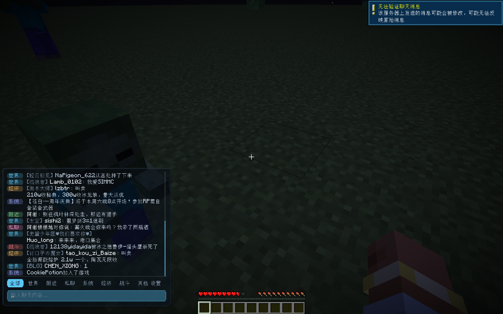
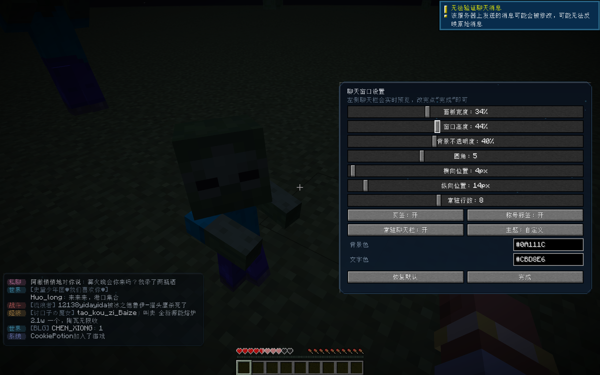
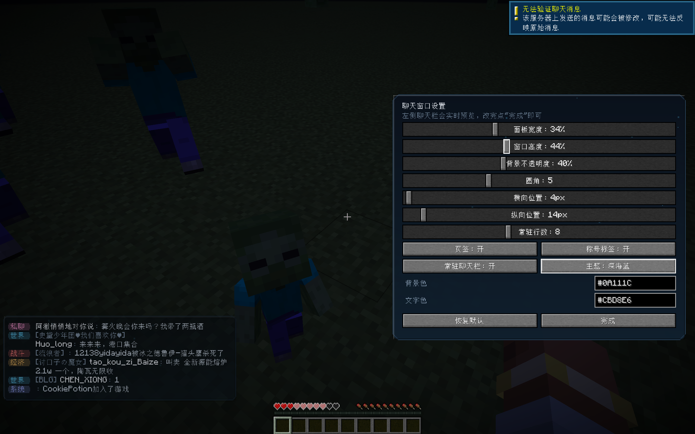
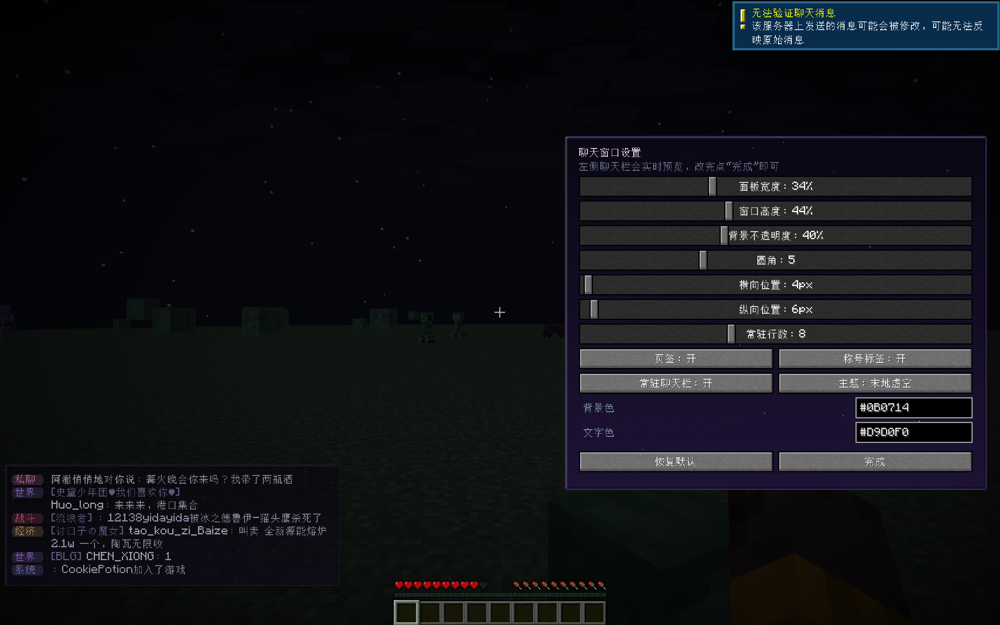
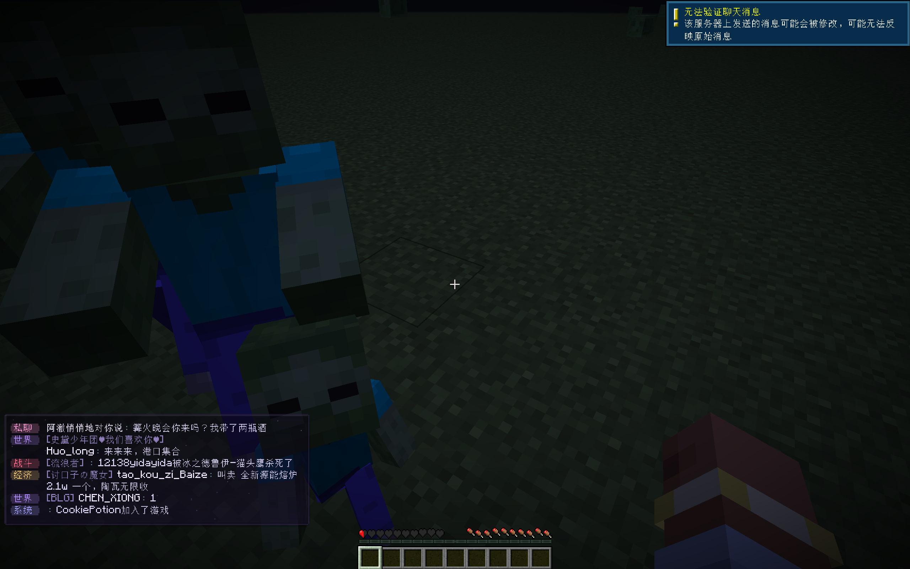
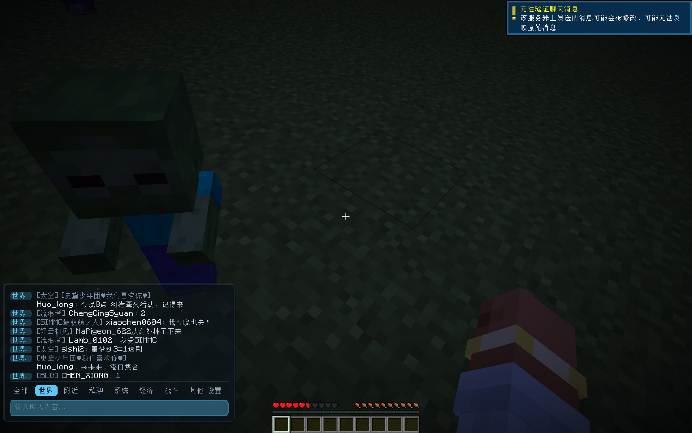

# Chat Window Plus · 聊天窗口优化

面向 **Minecraft 1.21.11 / Fabric** 的客户端聊天窗口模组：把原版挤在一起、颜色杂乱的聊天栏，
重做成带 **分类色签、筛选页签、滚动历史、圆角输入框** 的聊天窗口，并且可以在游戏内直接调位置、
大小、透明度、颜色和风格。

---

## 效果

| 打开聊天（按 `T`）             | 游戏内设置（按 `F7`）               |
| ----------------------- | --------------------------- |
|  |  |

| 主题：下界熔岩（暗红渐变 + 余烬火星）              | 主题：末地虚空（紫黑渐变 + 星点）                 |
| --------------------------------- | ---------------------------------- |
|  |  |

| 未打开聊天时的常驻聊天栏           | 只看「世界」频道                     |
| ---------------------- | ---------------------------- |
|  |  |

---

## 快速开始

1. **按 `T`** 打开聊天窗口，`Esc` 关闭。
2. **按 `F7`** 打开「聊天窗口设置」，改完点「完成」即可（也会自动保存）。
3. 也可以打开聊天后点页签行最右侧的 **「设置」**，或者输入 **`/cwp`**。

> 把 `chatwindowplus-1.0.3.jar` 放进整合包 `.minecraft/versions/<你的版本>/mods/` 里，
> 换新版本后需要**重启一次游戏**才会加载。

---

## 一、聊天窗口怎么用

| 操作                    | 说明                              |
| --------------------- | ------------------------------- |
| `T` / `Esc`           | 打开 / 关闭聊天                       |
| 点击底部页签                | `全部 世界 附近 私聊 系统 经济 战斗 其他`，只看某一类 |
| 鼠标滚轮                  | 翻看历史消息                          |
| `Shift` + 滚轮          | 逐行滚动                            |
| `PageUp` / `PageDown` | 按整屏翻历史                          |
| 点击消息里的链接              | 用系统浏览器打开 `http(s)` 链接           |
| 未打开聊天时                | 左下角常驻最近 N 行（默认 8 行），每条带分类色签     |

消息会按 `世界 / 附近 / 私聊 / 系统 / 经济 / 战斗 / 其他` 自动分类：
`[G]`、`[太空]`、`[称号]`、`[交易]`、`隐秘的声音 >>`、死亡提示、加入/退出等常见格式都能识别。

---

## 二、游戏内设置

### 打开方式（三种任选）

1. **按 `F7`**（默认快捷键）
2. 打开聊天（`T`）→ 点页签行最右侧的 **「设置」**
3. 输入 **`/cwp`**

`F7` 可以在「选项 → 控制 → 按键绑定 → 聊天窗口」里改键。

### 面板里能调什么

| 控件     | 范围        | 默认        | 作用                      |
| ------ | --------- | --------- | ----------------------- |
| 面板宽度   | 20% – 60% | 34%       | 占屏幕宽度比例                 |
| 窗口高度   | 25% – 75% | 44%       | 打开聊天时面板最多占屏幕高度比例        |
| 背景不透明度 | 5% – 100% | 40%       | 同时作用于「打开时」和「常驻栏」        |
| 圆角     | 0 – 16    | 5         | 圆角大小（MC 风格主题会改用 2px 切角） |
| 横向位置   | 0 – 300px | 4px       | 距屏幕左边缘                  |
| 纵向位置   | 0 – 200px | 14px      | 距屏幕底部                   |
| 常驻行数   | 3 – 16    | 8         | 未打开聊天时显示几行              |
| 页签     | 开 / 关     | 开         | 是否显示底部筛选页签              |
| 称号标签   | 开 / 关     | 开         | 是否显示 `[城镇]`、`[称号]` 等前缀  |
| 常驻聊天栏  | 开 / 关     | 开         | 未打开聊天时是否显示左下角聊天栏        |
| 主题     | 9 套预设     | 深海蓝       | 一键切换整套配色与纹理（见下）         |
| 背景色    | `#RRGGBB` | `#0A111C` | 面板底色；手动修改会把渐变改为纯色       |
| 文字色    | `#RRGGBB` | `#CBD8E6` | 正文颜色，旧消息也会同步刷新          |
| 恢复默认   | —         | —         | 回到初始配置                  |
| 完成     | —         | —         | 保存并关闭                   |

### 九套主题

点击「主题：xxx」按顺序切换，按钮文字会实时变成当前主题名；手动改过颜色后会显示
「主题：自定义」，再点一下会从第一套重新开始。

| 主题          | 底色   | 纹理        | 风格          |
| ----------- | ---- | --------- | ----------- |
| **深海蓝**（默认） | 深蓝渐变 | 上浮气泡      | 圆角，青色强调     |
| **下界熔岩**    | 暗红渐变 | 余烬火星      | 2px 切角，橙红强调 |
| **末地虚空**    | 紫黑渐变 | 星点        | 切角，紫色强调     |
| **钻石矿洞**    | 青黑渐变 | 晶面斜线      | 切角，青色强调     |
| **红石工程**    | 暗红渐变 | 红石线路      | 切角，红色强调     |
| **樱花原野**    | 粉黑渐变 | 花瓣        | 切角，粉色强调     |
| **金苹果**     | 暖金渐变 | 闪光十字      | 切角，金色强调     |
| **苔石地牢**    | 苔绿渐变 | 苔点        | 切角，绿色强调     |
| **石英大厅**    | 石灰渐变 | MC 式高光/阴影 | 切角，冷白强调     |

每套主题会同时换掉：面板渐变、边框、正文、名字、标签、强调色（页签选中/输入框描边/滚动条）、
以及 7 个分类色签的颜色。

### 实时预览与保存

- 设置界面**左侧的聊天栏就是实时预览**，背景、纹理、文字、位置会立刻变化。
- 点「完成」或按 `Esc` 关闭时写盘；拖动滑块后也会在几秒内自动保存。
- 保存位置：`config/chatwindowplus.json`，改完下次打开聊天自动生效。

---

## 三、配置文件

路径：`...\versions\simmc\config\chatwindowplus.json`（首次启动自动生成）。

| 字段                                     | 默认                                | 说明                                                                                       |
| -------------------------------------- | --------------------------------- | ---------------------------------------------------------------------------------------- |
| `enabled`                              | `true`                            | 总开关，关掉后恢复原版聊天                                                                            |
| `panelWidthRatio`                      | `0.335`                           | 面板宽度占屏幕比例                                                                                |
| `minPanelWidth` / `maxPanelWidth`      | `200` / `600`                     | 宽度上下限（GUI 像素）                                                                            |
| `openHeightRatio`                      | `0.44`                            | 打开时面板高度占屏幕比例上限                                                                           |
| `openMaxLines`                         | `40`                              | 打开时行数硬上限（实际还受 `openHeightRatio` 限制）                                                      |
| `hudMaxLines`                          | `8`                               | 常驻聊天栏行数                                                                                  |
| `hudPanelOpacity` / `openPanelOpacity` | `0.40`                            | 背景不透明度（`0.4` = 40% 不透明）                                                                  |
| `panelOffsetX` / `panelOffsetY`        | `4` / `14`                        | 距左边 / 距底部的像素                                                                             |
| `cornerRadius`                         | `5`                               | 圆角（切角主题下为 2px 切角）                                                                        |
| `chamfer`                              | `false`                           | 是否使用 MC 式 2px 切角                                                                         |
| `panelColor`                           | `#0A111C`                         | 面板基础色                                                                                    |
| `panelColorTop` / `panelColorBottom`   | `#0A111C` / `#10202F`             | 面板渐变的上/下颜色                                                                               |
| `borderColor`                          | `#233A50`                         | 边框色                                                                                      |
| `textColor` / `nameColor` / `tagColor` | `#CBD8E6` / `#F4F8FF` / `#7E92A8` | 正文 / 名字 / 标签颜色                                                                           |
| `accentColor`                          | `#5BC8F5`                         | 强调色（页签选中、输入框描边、滚动条）                                                                      |
| `categoryColors`                       | 7 个颜色                             | 分类色签：世界、附近、私聊、系统、经济、战斗、其他                                                                |
| `decor`                                | `bubbles`                         | 纹理：`none / bubbles / embers / stars / petals / moss / circuit / facets / glints / bevel` |
| `showTabs` / `showTags` / `hudEnabled` | `true`                            | 页签 / 称号标签 / 常驻栏开关                                                                        |
| `maxMessages`                          | `400`                             | 内存中保留的消息条数                                                                               |
| `defaultFilter`                        | `"ALL"`                           | 默认页签                                                                                     |
| `rules`                                | `[]`                              | 自定义分类规则                                                                                  |
| `debugChat`                            | `false`                           | 调试：把每条消息的「分类 + 原文」写进 `logs/latest.log`，排查分类问题用                                         |

### 自定义分类规则

`rules` 从上往下匹配（正则，忽略大小写），命中即采用；`category` 取值
`WORLD / NEARBY / PRIVATE / SYSTEM / ECONOMY / BATTLE / OTHER`。

```json
{
  "rules": [
    { "category": "ECONOMY", "pattern": "收.{0,6}冰龙娘" },
    { "category": "WORLD",   "pattern": "^\\[副本\\]" },
    { "category": "PRIVATE", "pattern": "悄悄" }
  ]
}
```

内置规则（在自定义规则之后生效）：

- **世界**：含 `[G]` / `[世界]` / `[全球]`
- **附近**：`[附近]` / `[本地]` / `[周边]`
- **私聊**：`[私聊]` 或「悄悄地对你说」
- **系统**：`隐秘的声音`、`[系统]`、`[公告]`、加入/退出
- **经济**：`[交易]` / `[经济]` / `[市场]`
- **战斗**：死亡提示（被…杀死、熔岩游泳、摔落、刺死…）
- **其他**：其余消息

---

## 四、安装 / 更新

1. 游戏版本 **Fabric 1.21.11**，需要 **Fabric Loader 0.19+** 与 **Fabric API**。
2. 下载 [`chatwindowplus-1.0.3.jar`](https://github.com/wuyunfeng-art/chatwindowplus/releases/latest/download/chatwindowplus-1.0.3.jar)
   （也可以直接用仓库里的 `dist/chatwindowplus-1.0.3.jar`）。
3. 放进整合包的 `.minecraft/versions/<你的版本>/mods/` 目录。
4. 重启游戏。

---

## 五、兼容性与已知限制

- 只接管聊天**显示**，不改变消息签名、举报、发送逻辑。
- 与 `chat_heads` 这类直接改写原版聊天渲染的模组可能视觉叠加（不会崩溃）。
- 聊天记录保存在内存里，重启游戏后清空（和原版一致）。
- 极窄窗口下最小宽度 200 GUI 像素，可能显得偏宽，可调 `panelWidthRatio`。
- 手动改「背景色」会把渐变压成纯色；想要渐变请在配置里填 `panelColorTop` / `panelColorBottom`。

---

## 六、从源码构建

```powershell
cd mod
$env:JAVA_HOME = "..\tools\jdk25\jdk-25"
..\tools\gradle-9.9.2\bin\gradle.bat build
# 产物：build/libs/chatwindowplus-1.0.3.jar
```

技术栈：Fabric Loom 1.19.4、Yarn 1.21.11+build.6、JDK 25 编译（字节码 21）。

### 自动测试

- `runClientPreview`：在标题界面预览窗口并自动截图
- `runClientChatTest`：连接本地 `127.0.0.1:25665` 测试服，自动打开真实聊天界面、切换页签、
  打开设置、点击主题按钮、切换主题并截图（需要本地测试服）

---

## 七、项目结构

```
mod/                        模组源码（Fabric / Java 21）
mod/src/main/java/com/chatwindowplus/
  chat/                     消息解析与分类
  config/                   配置读写
  mixin/                    聊天界面 Mixin
  ui/                       渲染、主题、设置界面
docs/                       README 用截图
dist/                       已构建的 jar（chatwindowplus-1.0.3.jar）
```

- 配置文件：`.minecraft/config/chatwindowplus.json`，首次启动自动生成。
- 重新编译需要本地 JDK 25 与 Gradle 9（见上一节的命令）；`tools/`、构建缓存和测试服都不入库。

---

## 常见问题

**按 F7 没反应？**
可能和别的模组键位冲突，或还没重启加载新版本。可在「选项 → 控制 → 按键绑定 → 聊天窗口」
里确认/修改快捷键，或用 `/cwp`，或打开聊天点「设置」。

**想恢复原版聊天？**
把配置里的 `enabled` 改成 `false`（下次打开聊天生效），或直接删掉模组 jar。

**40% 透明度太透/太实？**
设置里拖动「背景不透明度」，或改 `openPanelOpacity` / `hudPanelOpacity`。

**主题看起来变纯色了？**
手动改过「背景色」会覆盖渐变。重新点一下主题按钮，或在配置里恢复
`panelColorTop` / `panelColorBottom`。

**私信 / 附近的消息还是被分到「其他」？**
先在配置里把 `debugChat` 改成 `true` 并重进游戏，`logs/latest.log` 会按
`[CWP] 分类 | 原文` 记录每一条消息。把没认出来的那几行发来，就能按你服务器的真实写法补规则；
也可以自己在 `rules` 里加一条正则，例如
`{"category": "PRIVATE", "pattern": "^\\[私信\\]"}`。
